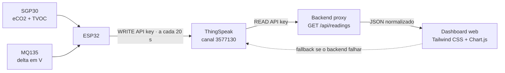

# Monitoramento da Qualidade do Ar

Dashboard web em tempo real para acompanhar a qualidade do ar medida por um ESP32 com sensores SGP30 (eCO2 e TVOC) e MQ135 (variação de gases). Os dados são publicados no ThingSpeak, passam por um backend proxy e são exibidos em uma SPA responsiva com Tailwind CSS e Chart.js.

## Visão geral

- Aquisição: ESP32 lê SGP30 e MQ135 e envia 5 campos ao ThingSpeak a cada 20 segundos.
- Persistência: canal ThingSpeak `3577130`, endpoint de leitura com `READ API key`.
- Backend: expõe `GET /api/readings`, normaliza os feeds e aplica cache de 20 segundos.
- Frontend: consome o backend a cada 20 segundos; se falhar, usa o ThingSpeak diretamente como fallback.
- Interface: três abas (Dashboard, Histórico de Medições e Painel de Alertas), dark mode, gráfico com eixos Y separados e alertas dinâmicos.

> O contrato de API é a fonte da verdade: [`docs/API_CONTRACT.md`](docs/API_CONTRACT.md).

## Arquitetura



Fluxo resumido:

```text
ESP32 + SGP30 + MQ135 → ThingSpeak → backend proxy → dashboard web
```

## Campos e níveis

### Campos publicados

| ThingSpeak | Chave no JSON da API | Significado | Unidade / valores |
|---|---|---|---|
| `field1` | `eco2` | CO2 equivalente (SGP30) | ppm |
| `field2` | `tvoc` | Compostos orgânicos voláteis (SGP30) | ppb |
| `field3` | `mq135` | Variação do MQ135 (delta) | V |
| `field4` | `alerta` | Estado do alerta | `0` normal, `1` alerta |
| `field5` | `nivel` | Nível geral da qualidade do ar | `0` a `2` |

### Níveis de qualidade

Os três níveis correspondem aos três LEDs do circuito.

| `field5` | Nome | Cor | LED do firmware |
|---:|---|---|---|
| `0` | BOA | verde | verde |
| `1` | MODERADA | amarelo | amarelo |
| `2` | RUIM | vermelho | vermelho |

Regra de alerta: `alerta == 1` **ou** `nivel >= 1`. O firmware envia `alerta = 1` sempre que o nível é MODERADA ou RUIM. A gravidade define a cor do destaque: amarelo para MODERADA e vermelho para RUIM.

## Execução

### Firmware

1. Entre em `firmware/` e edite `main/secrets.h` com `WIFI_SSID`, `WIFI_PASSWORD` e `THINGSPEAK_WRITE_KEY`.
2. Nunca versionar segredos reais: mantenha apenas valores de exemplo no repositório.
3. Compile e grave no ESP32 com PlatformIO:

```bash
cd firmware
pio run --target upload
pio device monitor
```

4. Confira no monitor serial (115200 baud) se os envios ao canal `3577130` estão ocorrendo a cada 20 segundos.

> Se o projeto estiver sendo usado diretamente na Arduino IDE, abra a pasta `firmware`, ajuste `main/secrets.h` e faça o upload normalmente.

### Backend

1. Entre em `backend/` e crie o arquivo `.env`:

```env
PORT=3000
THINGSPEAK_CHANNEL_ID=3577130
THINGSPEAK_READ_KEY=<SUA_READ_API_KEY>
```

2. Instale as dependências e inicie o servidor:

```bash
cd backend
npm install
npm start
```

3. O proxy ficará disponível em `http://localhost:3000/api/readings` e servirá os arquivos de `web/` na raiz. A porta padrão é `3000` e pode ser alterada pela variável `PORT`.

### Frontend

1. Copie o modelo de configuração e informe sua chave de leitura:

```bash
cp web/config.example.js web/config.js
```

2. Edite `web/config.js`:

```javascript
window.THINGSPEAK_CONFIG = {
  channelId: '3577130',
  readApiKey: '<SUA_READ_API_KEY>',
  results: 30,
};
```

`web/config.js` é ignorado pelo Git. O arquivo `web/config.example.js` é o modelo versionado e não deve conter chaves reais.

3. Com o backend rodando, acesse `http://localhost:3000/`.

Se `GET /api/readings` falhar, a interface tenta automaticamente `https://api.thingspeak.com/channels/3577130/feeds.json` com a chave configurada, normaliza os campos `field1`–`field5` para o mesmo formato do contrato e exibe um aviso discreto. Se ambas as fontes falharem, a última leitura recebida permanece na tela e o indicador muda para `Erro`.

Tailwind CSS e Chart.js são carregados por CDN, portanto é necessário ter acesso à internet ao abrir o dashboard.

## Estrutura de pastas

```text
.
├── docs/
│   └── API_CONTRACT.md
├── firmware/
│   └── main/
│       └── secrets.h
├── backend/
│   └── .env
├── web/
│   ├── .gitignore
│   ├── config.example.js
│   ├── config.js
│   ├── index.html
│   ├── styles.css
│   └── app.js
└── README.md
```

- `docs/API_CONTRACT.md`: contrato entre firmware, backend e frontend.
- `firmware/`: código do ESP32 e credenciais locais de Wi-Fi/ThingSpeak.
- `backend/`: proxy da API ThingSpeak e arquivo `.env` local.
- `web/`: SPA estática, sem etapa de build.
- `web/app.js`: constantes da API, polling, fallback, normalização, gráfico e alertas.
